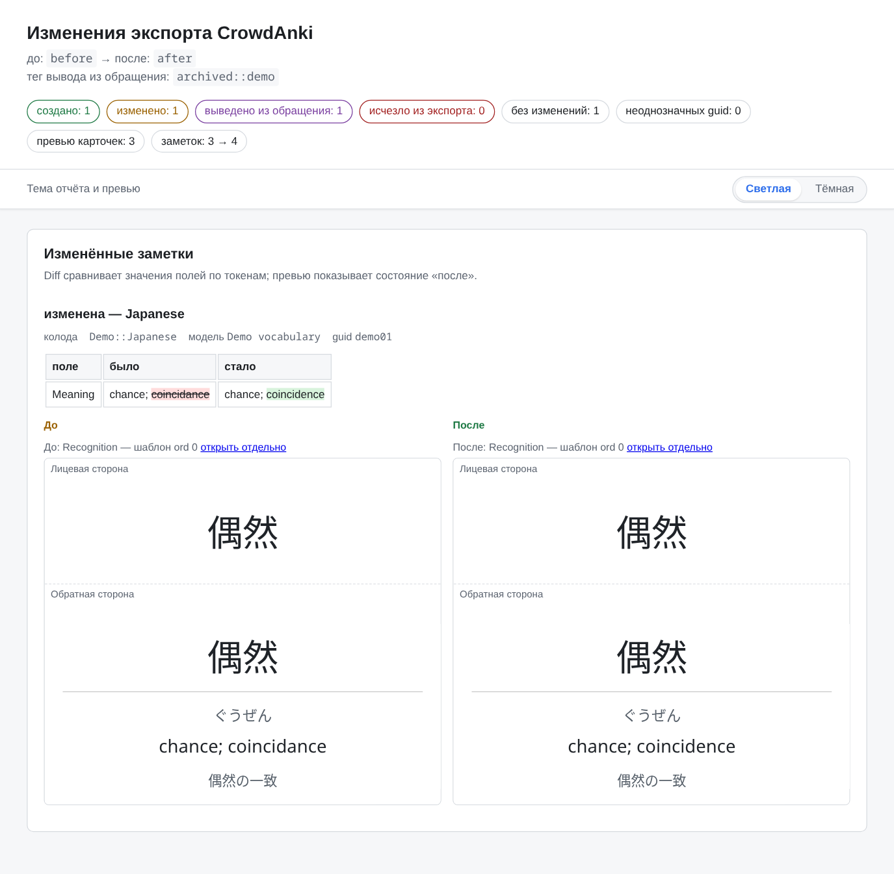
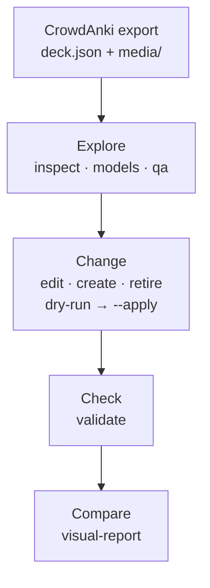

<div align="center">

# Anki Deck Toolkit

**Verifiable work on Anki decks in CrowdAnki JSON — from a first look at an export to a before/after report.**

[Русский](README.md) · **English** · [简体中文](README.zh-CN.md)

[](https://github.com/Flandre-Scarlet-the-best/anki-deck-toolkit/actions/workflows/ci.yml)
[](https://github.com/Flandre-Scarlet-the-best/anki-deck-toolkit/actions/workflows/codeql.yml)
[](Cargo.toml)

[](https://github.com/Stvad/CrowdAnki)
[](LICENSE)
[](https://github.com/Flandre-Scarlet-the-best/anki-deck-toolkit/commits/main)
[](https://deepwiki.com/Flandre-Scarlet-the-best/anki-deck-toolkit)

</div>

> **Translation note:** this translation may lag behind. The Russian original is authoritative for technical details; translation and proofreading PRs are welcome.

Anki Deck Toolkit is a set of Rust CLI tools for **local CrowdAnki exports**: it shows what is inside a multi-megabyte `deck.json`, finds structural problems, applies targeted changes only with an explicit `--apply`, and builds an offline report with card previews. It is a toolkit, not a collection of ready-made decks: your decks stay local and never go into Git.

**[Quick start](#quick-start)** · **[Features](#features)** · **[Safety and boundaries](#safety-and-boundaries)** · **[Documentation](#documentation)**

<p align="center">
  <picture>
    <source media="(prefers-color-scheme: dark)" srcset="docs/assets/readme/visual-report-dark.png">
    
  </picture>
  <br>
  <sub>A real <code>visual-report</code> for the synthetic demo deck in this repository: the summary and the changed-notes section. The report UI is currently Russian-only. <a href="docs/assets/readme/README.md">How the screenshot was made (Russian)</a>.</sub>
</p>

## Features

### Understand a deck without opening the JSON

`inspect`, `find`, `stats`, and `models` show the deck tree, note types, actual fields, and media. `validate` checks the CrowdAnki structure, identifiers, and media references. The `qa` → `review` → `review-check` pipeline selects problematic notes in compact batches for an external agent or a human and turns their proposals into a ready edit request. The toolkit itself never calls an LLM API and does not judge translation quality. → [`anki-repo`](docs/en/anki-repo/README.md)

### Change exactly what you mean

There are four mutating commands, each with a narrow scope: `edit` changes the value of an existing field and requires the expected old value, `create` adds notes to an existing deck and note type, `retire` marks a note with a retirement tag instead of deleting it (it does not change Anki scheduling: suspending or deleting the cards is a separate step in Anki), and `migrate-media` moves only proven media references to the canonical file name. Without `--apply`, each one shows the plan and its checks without writing anything. → [command contracts](docs/en/anki-repo/README.md#commands)

### See the changes

`visual-report` matches two states of an export by `guid` and writes an offline HTML directory: outcome counters, a field-by-field diff, and card previews rendered from the note type's templates and CSS, in light and dark themes. Previews are a static approximation, not Anki's renderer: cloze, furigana, and other filters are not evaluated, and the report lists its own limitations. → [`visual-report`](docs/en/anki-repo/README.md#visual-report)

### Assets for Japanese decks

`kanji-assets` fetches kanji images from Yarxi and, after semantic verification, stores them in a local verified corpus. `pitch-assets` manages JPDB pitch-accent images, and `pronunciation-assets forvo` handles MP3 candidates from Forvo through a browser signed in with your account. A human confirms that the reading is correct. `create` can insert only already verified images, and only into fields explicitly allowed by the rules. → [`asset-store`](docs/en/asset-store/README.md) · [Forvo (Russian)](docs/ru/asset-store/forvo.md)

### Work with Anki Desktop

The `anki-repo anki` group diagnoses an installed Anki (`doctor`), prepares AnkiConnect and the original CrowdAnki add-on (`setup`), launches the app, and exports or imports through CrowdAnki. Linux uses Linux Anki; WSL uses Windows Anki. Writing operations require a selected profile and `--apply`. → [Desktop integration (Russian)](docs/ru/anki-repo/desktop.md)

### Measure performance and test the integration

`benchmark-contract`, `benchmark-runner`, and `benchmark-history` define scenarios, run series with Hyperfine, and keep a local history for comparable results. `anki-e2e` starts a real Anki Desktop in an isolated Docker container for explicit E2E runs. Neither runs automatically in CI. → [performance](docs/en/performance/README.md) · [E2E stand](docs/en/anki-e2e/README.md)

## How it works



Each stage is a separate command with its own report, so you can always stop between stages and inspect the result. Kanji and pitch-accent assets, Anki Desktop, and benchmarks are independent subsystems around this path, not mandatory steps of it.

## Quick start

You need Linux (WSL works too) and Rust no older than the MSRV declared in the root `Cargo.toml`.

```bash
git clone https://github.com/Flandre-Scarlet-the-best/anki-deck-toolkit.git
cd anki-deck-toolkit
cargo build --release --locked -p anki-repo
```

**Try it without your own deck.** The repository ships a synthetic [demo deck](docs/assets/readme/demo-export/deck.json) with three notes and a deliberate typo. Work on a copy in a temporary directory — the report must live outside `decks/`:

```bash
AR=./target/release/anki-repo
DEMO=$(mktemp -d)
cp -r docs/assets/readme/demo-export "$DEMO/before"
cp -r "$DEMO/before" "$DEMO/after"

$AR inspect "$DEMO/before"       # what is inside the export
$AR validate "$DEMO/before"      # is the structure valid

# dry run: shows the change and its checks, leaves the file untouched
$AR edit "$DEMO/after" --guid demo01 --field Meaning \
  --expect 'chance; coincidance' --set 'chance; coincidence'

# the same edit, written to disk
$AR edit "$DEMO/after" --guid demo01 --field Meaning \
  --expect 'chance; coincidance' --set 'chance; coincidence' --apply

$AR visual-report --before "$DEMO/before" --after "$DEMO/after" --out "$DEMO/report"
echo "$DEMO/report/index.html"   # open this file in a browser
```

**Your own deck.** Export a deck from Anki with CrowdAnki and put the export directory into `decks/output/<export_name>/`. A fresh clone has no `decks/` directory: Git ignores it entirely, and only you fill it. Commands take the export directory, not the path to `deck.json`; start with `inspect`, `validate`, and `models` — the last one shows the actual field names you need for `edit` and `create`.

## Safety and boundaries

- **Nothing is written without `--apply`.** `edit`, `create`, `retire`, and `migrate-media` run as a dry run by default. Before writing, the candidate is re-parsed and checked; if anything fails, the file stays as it was.
- **Narrow changes.** The toolkit does not create or delete decks, note types, or fields, does not change `guid` values or CrowdAnki UUIDs, and never physically deletes notes.
- **Your data stays with you.** Git ignores `decks/` and `.asset-store/` entirely, and CI checks that nothing inside them is tracked. Commands that work on exports never touch the network; only `anki-repo anki` (local AnkiConnect and official AnkiWeb packages) and asset acquisition (Yarxi, JPDB, Forvo) do.
- **No sync yet.** `anki-repo anki` performs individual export and import operations through Desktop. The `anki_repo::exchange` library stores revisions and compares states, but automatic `decks/input/ ↔ decks/output/` exchange does not exist yet, and `decks/input/` is closed to regular commands. → [exchange contract (Russian)](docs/ru/anki-repo/exchange.md)

The full threat model is in [`SECURITY_MODEL.md`](SECURITY_MODEL.md) (Russian).

## Documentation

| Tool | Purpose | Docs |
|---|---|---|
| `anki-repo` | inspection, QA, targeted edits, `visual-report` | [README](docs/en/anki-repo/README.md) |
| `anki-repo anki` | Anki Desktop: diagnostics, AnkiConnect, CrowdAnki | [desktop.md (Russian)](docs/ru/anki-repo/desktop.md) |
| `anki_repo::exchange` | revision and A/C/B comparison library | [exchange.md (Russian)](docs/ru/anki-repo/exchange.md) |
| `asset-store` | kanji, JPDB pitch accent, Forvo pronunciation | [README](docs/en/asset-store/README.md) · [Forvo (Russian)](docs/ru/asset-store/forvo.md) |
| `repository-maintenance` | disk usage inventory and safe build cleanup | [README](docs/en/repository-maintenance/README.md) |
| `anki-e2e` | isolated Anki Desktop stand in Docker | [README](docs/en/anki-e2e/README.md) |
| `benchmark-contract` · `-runner` · `-history` | scenarios, runs, and measurement history | [methodology](docs/en/performance/README.md) · [catalog](docs/en/performance/benchmarks.md) · [runner](docs/en/benchmark-runner/README.md) · [history](docs/en/benchmark-history/README.md) |

For AI agents: [`AGENTS.md`](AGENTS.md) sets the invariants, [`.codex/context/INDEX.md`](.codex/context/INDEX.md) routes to contract owners, and [`.agents/skills/`](.agents/skills/) holds the workflows (all in Russian).

<details>
<summary><strong>Development and checks</strong></summary>

Build and run checks from the root of the Cargo workspace:

```bash
cargo fmt --all --check
cargo clippy --workspace --all-targets --locked -- -D warnings
cargo test --workspace --locked
```

Tests build their own synthetic exports and never read `decks/`. GitHub Actions repeats these checks and additionally verifies the MSRV, script contracts, Markdown links, PR description structure, and the user-data boundary. Heavy E2E runs and benchmarks are not part of CI. Details: [`.codex/context/03-VERIFICATION.md`](.codex/context/03-VERIFICATION.md); translation rules: [`docs/ru/contributing/translations.md`](docs/ru/contributing/translations.md) (both in Russian).

</details>

## License

The project's own code, automation, configuration, and original documentation are licensed under **GNU AGPL-3.0-only**. The license does not automatically apply to user decks, downloaded third-party assets, or tool output (HTML reports, processed images): their legal status depends on the source content, its rights holders, and the source terms. The project claims no rights to third-party material.

[AGPL-3.0 text](LICENSE) · [Licensing scope and asset rights](docs/en/licensing/README.md)
