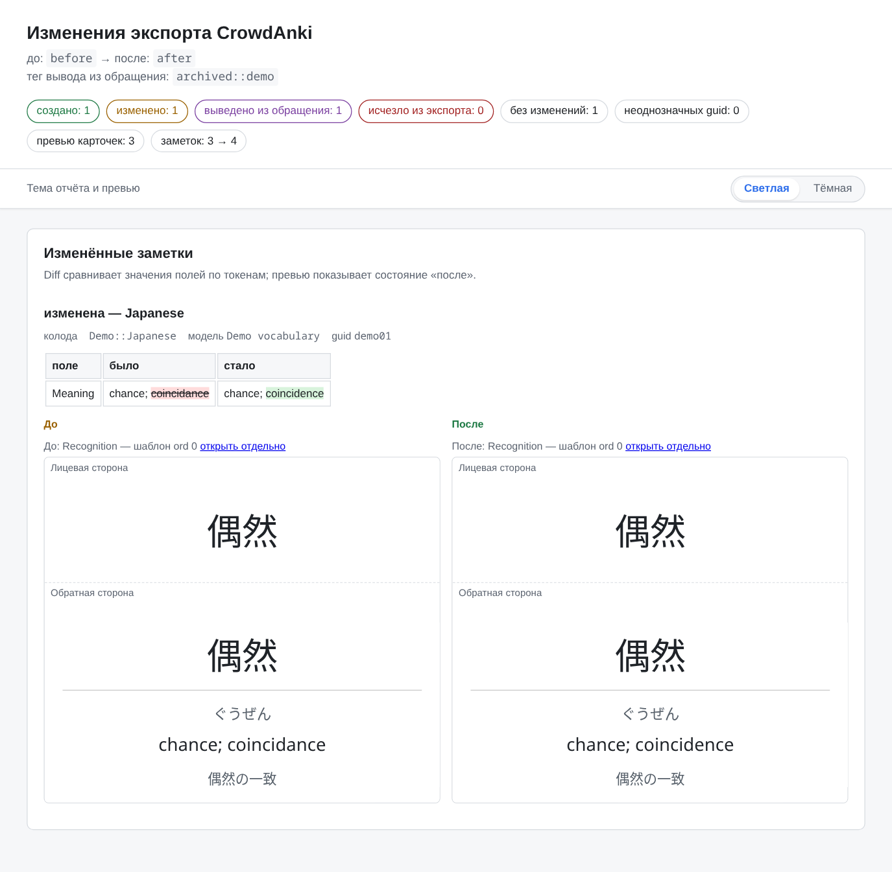
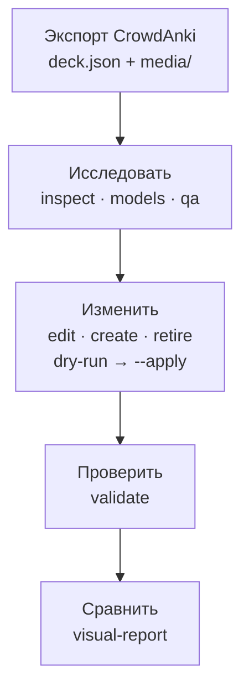

<div align="center">

# Anki Deck Toolkit

**Проверяемая работа с Anki-колодами в формате CrowdAnki JSON — от первого взгляда на экспорт до отчёта «до / после».**

**Русский** · [English](README.en.md) · [简体中文](README.zh-CN.md)

[](https://github.com/Flandre-Scarlet-the-best/anki-deck-toolkit/actions/workflows/ci.yml)
[](https://github.com/Flandre-Scarlet-the-best/anki-deck-toolkit/actions/workflows/codeql.yml)
[](Cargo.toml)

[](https://github.com/Stvad/CrowdAnki)
[](LICENSE)
[](https://github.com/Flandre-Scarlet-the-best/anki-deck-toolkit/commits/main)
[](https://deepwiki.com/Flandre-Scarlet-the-best/anki-deck-toolkit)

</div>

Anki Deck Toolkit — набор Rust CLI для **локальных экспортов CrowdAnki**: он показывает, что лежит в многомегабайтном `deck.json`, находит структурные проблемы, вносит точечные изменения только по явному `--apply` и строит офлайн-отчёт с превью карточек. Это инструментарий, а не каталог готовых колод: свои колоды вы держите локально, в Git они не попадают.

**[Быстрый старт](#быстрый-старт)** · **[Возможности](#возможности)** · **[Безопасность и границы](#безопасность-и-границы)** · **[Документация](#документация)**

<p align="center">
  <picture>
    <source media="(prefers-color-scheme: dark)" srcset="docs/assets/readme/visual-report-dark.png">
    
  </picture>
  <br>
  <sub>Настоящий <code>visual-report</code> по синтетической демо-колоде из этого репозитория: сводка и раздел изменённых заметок. <a href="docs/assets/readme/README.md">Как получен скриншот</a>.</sub>
</p>

## Возможности

### Понять колоду, не открывая JSON

`inspect`, `find`, `stats` и `models` показывают дерево колод, модели, фактические поля и медиа. `validate` проверяет структуру CrowdAnki, идентификаторы и ссылки на медиа. Конвейер `qa` → `review` → `review-check` отбирает проблемные заметки компактными пакетами для внешнего агента или человека и превращает их предложения в готовый запрос правки. Набор инструментов сам не вызывает LLM API и не судит о качестве перевода. → [`anki-repo`](docs/ru/anki-repo/README.md)

### Менять точечно и предсказуемо

Изменяющих команд четыре, и у каждой узкий предмет: `edit` меняет значение существующего поля и требует ожидаемое старое значение, `create` добавляет заметки в уже существующую колоду и модель, `retire` выводит заметку из обращения тегом вместо удаления, `migrate-media` переводит только доказанные медиассылки на каноническое имя. Без `--apply` каждая показывает план и проверки, ничего не записывая. → [контракты команд](docs/ru/anki-repo/README.md#команды)

### Видеть изменения глазами

`visual-report` сравнивает два состояния экспорта по `guid` и собирает офлайн-каталог HTML: счётчики исходов, построчный diff полей и превью карточек по шаблонам и CSS модели в светлой и тёмной теме. Превью — статическое приближение, а не рендер Anki: cloze, furigana и другие фильтры не вычисляются, и отчёт сам перечисляет свои ограничения. → [`visual-report`](docs/ru/anki-repo/README.md#visual-report)

### Ресурсы для японских колод

`kanji-assets` получает изображения кандзи из Yarxi и после семантической проверки помещает их в локальный проверенный корпус. `pitch-assets` ведёт изображения тонового ударения JPDB, `pronunciation-assets forvo` — MP3-кандидаты с Forvo через браузер с вашей учётной записью. Правильность чтения подтверждает человек. `create` может вставить в поле только уже подтверждённые изображения и только там, где это явно разрешено правилами. → [`asset-store`](docs/ru/asset-store/README.md) · [Forvo](docs/ru/asset-store/forvo.md)

### Работать с Anki Desktop

Группа `anki-repo anki` диагностирует установленный Anki (`doctor`), готовит AnkiConnect и оригинальный CrowdAnki (`setup`), запускает приложение и выполняет экспорт или импорт через CrowdAnki. В Linux используется Linux Anki, в WSL — Windows Anki. Записывающие операции требуют выбранного профиля и `--apply`. → [интеграция Desktop](docs/ru/anki-repo/desktop.md)

### Измерять и проверять интеграцию

`benchmark-contract`, `benchmark-runner` и `benchmark-history` описывают сценарии, запускают серии через Hyperfine и хранят локальную историю для сопоставимых сравнений. `anki-e2e` поднимает настоящий Anki Desktop в изолированном Docker-контейнере для явных E2E-прогонов. Ни то ни другое не запускается в CI автоматически. → [производительность](docs/ru/performance/README.md) · [E2E-стенд](docs/ru/anki-e2e/README.md)

## Как это работает



Каждая стадия — отдельная команда с собственным отчётом, поэтому между ними всегда можно остановиться и посмотреть на результат. Ресурсы кандзи и ударения, Anki Desktop и бенчмарки — самостоятельные подсистемы вокруг этого пути, а не обязательные его шаги.

## Быстрый старт

Нужны Linux (подходит и WSL) и Rust версии не ниже MSRV из корневого `Cargo.toml`.

```bash
git clone https://github.com/Flandre-Scarlet-the-best/anki-deck-toolkit.git
cd anki-deck-toolkit
cargo build --release --locked -p anki-repo
```

**Попробовать без своей колоды.** В репозитории есть синтетическая [демо-колода](docs/assets/readme/demo-export/deck.json) из трёх заметок с намеренной опечаткой. Работайте с её копией во временном каталоге — отчёт обязан лежать вне `decks/`:

```bash
AR=./target/release/anki-repo
DEMO=$(mktemp -d)
cp -r docs/assets/readme/demo-export "$DEMO/before"
cp -r "$DEMO/before" "$DEMO/after"

$AR inspect "$DEMO/before"       # что внутри экспорта
$AR validate "$DEMO/before"      # корректна ли структура

# пробный запуск: показывает изменение и проверки, файл не трогает
$AR edit "$DEMO/after" --guid demo01 --field Meaning \
  --expect 'chance; coincidance' --set 'chance; coincidence'

# та же правка с записью
$AR edit "$DEMO/after" --guid demo01 --field Meaning \
  --expect 'chance; coincidance' --set 'chance; coincidence' --apply

$AR visual-report --before "$DEMO/before" --after "$DEMO/after" --out "$DEMO/report"
echo "$DEMO/report/index.html"   # откройте этот файл в браузере
```

**Своя колода.** Экспортируйте колоду из Anki через CrowdAnki и положите каталог экспорта в `decks/output/<имя_экспорта>/`. В чистом clone каталога `decks/` нет: он целиком игнорируется Git и заполняется только вами. Командам передаётся каталог экспорта, а не путь к `deck.json`; начните с `inspect`, `validate` и `models` — последняя покажет фактические имена полей, которые нужны для `edit` и `create`.

## Безопасность и границы

- **Без `--apply` ничего не записывается.** `edit`, `create`, `retire` и `migrate-media` по умолчанию работают в режиме пробного запуска. Перед записью кандидат повторно разбирается и проверяется, а при любом отказе файл остаётся прежним.
- **Узкие правки.** Набор инструментов не создаёт и не удаляет колоды, модели и поля, не меняет `guid` и UUID CrowdAnki и не удаляет заметки физически.
- **Данные остаются у вас.** `decks/` и `.asset-store/` игнорируются Git целиком, а CI проверяет, что внутри них ничего не отслеживается. Команды работы с экспортом не ходят в сеть; в сеть обращаются только `anki-repo anki` (локальный AnkiConnect и официальные пакеты AnkiWeb) и получение ресурсов (Yarxi, JPDB, Forvo).
- **Синхронизации пока нет.** `anki-repo anki` выполняет отдельные операции экспорта и импорта через Desktop. Библиотека `anki_repo::exchange` хранит ревизии и сравнивает состояния, но автоматического обмена `decks/input/ ↔ decks/output/` ещё нет, а `decks/input/` закрыт для обычных команд. → [контракт обмена](docs/ru/anki-repo/exchange.md)

Подробная модель угроз — в [`SECURITY_MODEL.md`](SECURITY_MODEL.md).

## Документация

| Инструмент | Для чего | Документация |
|---|---|---|
| `anki-repo` | анализ, QA, точечные правки, `visual-report` | [README](docs/ru/anki-repo/README.md) |
| `anki-repo anki` | Anki Desktop: диагностика, AnkiConnect, CrowdAnki | [desktop.md](docs/ru/anki-repo/desktop.md) |
| `anki_repo::exchange` | библиотека ревизий и сравнения A/C/B | [exchange.md](docs/ru/anki-repo/exchange.md) |
| `asset-store` | кандзи, ударение JPDB, произношение Forvo | [README](docs/ru/asset-store/README.md) · [Forvo](docs/ru/asset-store/forvo.md) |
| `repository-maintenance` | учёт места на диске и безопасная очистка сборки | [README](docs/ru/repository-maintenance/README.md) |
| `anki-e2e` | изолированный стенд Anki Desktop в Docker | [README](docs/ru/anki-e2e/README.md) |
| `benchmark-contract` · `-runner` · `-history` | сценарии, запуск и история измерений | [методика](docs/ru/performance/README.md) · [каталог](docs/ru/performance/benchmarks.md) · [runner](docs/ru/benchmark-runner/README.md) · [history](docs/ru/benchmark-history/README.md) |

Для ИИ-агентов: [`AGENTS.md`](AGENTS.md) задаёт инварианты, [`.codex/context/INDEX.md`](.codex/context/INDEX.md) ведёт к владельцам контрактов, а [`.agents/skills/`](.agents/skills/) содержит рабочие процессы.

<details>
<summary><strong>Разработка и проверки</strong></summary>

Сборка и проверки запускаются из корня рабочего пространства Cargo:

```bash
cargo fmt --all --check
cargo clippy --workspace --all-targets --locked -- -D warnings
cargo test --workspace --locked
```

Тесты строят собственные синтетические экспорты и не читают `decks/`. GitHub Actions повторяет эти проверки и дополнительно проверяет MSRV, контракты скриптов, ссылки в Markdown, структуру описания PR и границу пользовательских данных. Тяжёлые E2E-прогоны и бенчмарки в CI не входят. Подробности — [`.codex/context/03-VERIFICATION.md`](.codex/context/03-VERIFICATION.md); правила переводов — [`docs/ru/contributing/translations.md`](docs/ru/contributing/translations.md).

</details>

## Лицензия

Собственный код, автоматизация, конфигурация и авторская документация проекта распространяются по **GNU AGPL-3.0-only**. Лицензия не применяется автоматически к пользовательским колодам, скачанным сторонним ресурсам и результатам работы инструментов (HTML-отчётам, обработанным изображениям): их правовой режим определяют исходное содержимое, правообладатели и условия источников. Проект не заявляет прав на сторонние материалы.

[Текст AGPL-3.0](LICENSE) · [Границы лицензирования и права на ресурсы](docs/ru/licensing/README.md)
