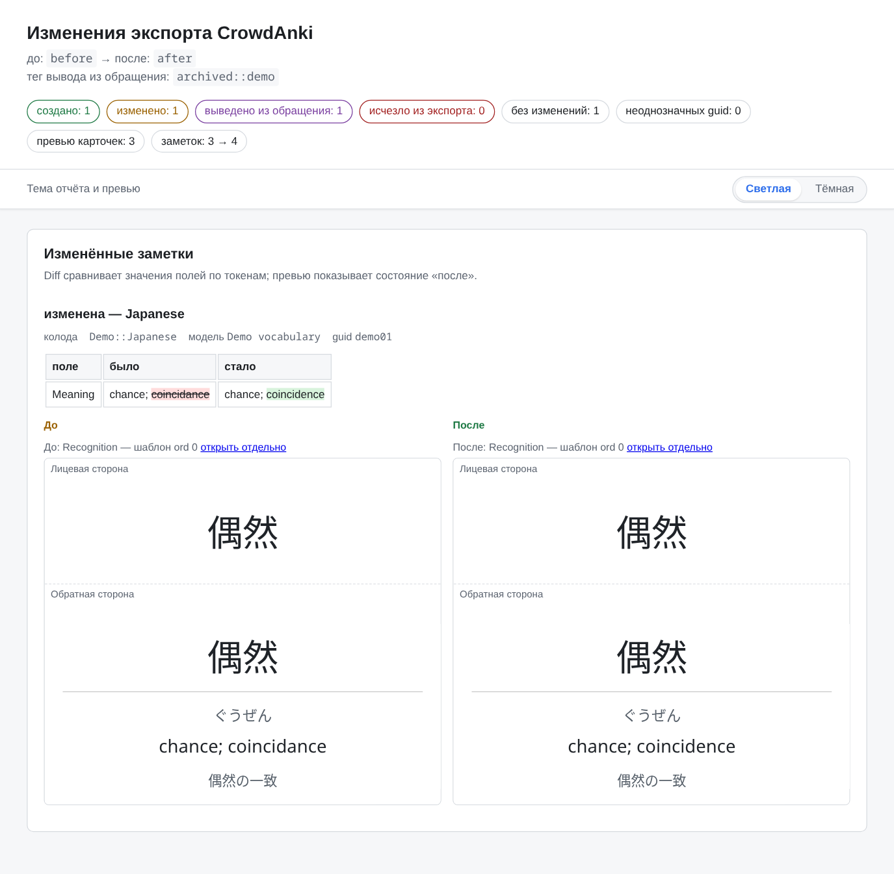
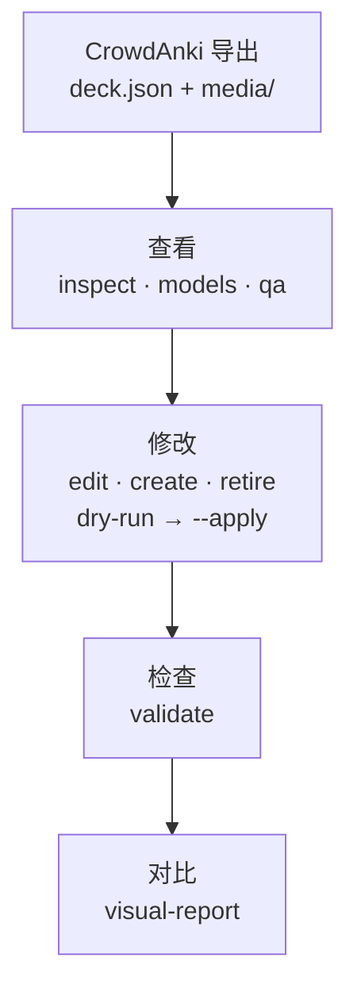

<div align="center">

# Anki Deck Toolkit

**以可核查的方式处理 CrowdAnki JSON 格式的 Anki 牌组——从初次查看导出数据到“修改前 / 修改后”报告。**

[Русский](README.md) · [English](README.en.md) · **简体中文**

[](https://github.com/Flandre-Scarlet-the-best/anki-deck-toolkit/actions/workflows/ci.yml)
[](https://github.com/Flandre-Scarlet-the-best/anki-deck-toolkit/actions/workflows/codeql.yml)
[](Cargo.toml)

[](https://github.com/Stvad/CrowdAnki)
[](LICENSE)
[](https://github.com/Flandre-Scarlet-the-best/anki-deck-toolkit/commits/main)
[](https://deepwiki.com/Flandre-Scarlet-the-best/anki-deck-toolkit)

</div>

> **翻译提示：** 本译文可能未及时更新，技术内容以俄语原文为准。欢迎提交翻译和校对改进。

Anki Deck Toolkit 是一组面向**本地 CrowdAnki 导出数据**的 Rust 命令行工具：它能展示数 MB 大小的 `deck.json` 中有什么、发现结构问题、仅在显式 `--apply` 时执行定向修改，并生成带卡片预览的离线报告。本仓库提供的是工具，而不是现成牌组：你的牌组保存在本地，不会进入 Git。

**[快速开始](#快速开始)** · **[功能](#功能)** · **[安全与边界](#安全与边界)** · **[文档](#文档)**

<p align="center">
  <picture>
    <source media="(prefers-color-scheme: dark)" srcset="docs/assets/readme/visual-report-dark.png">
    
  </picture>
  <br>
  <sub>基于本仓库合成演示牌组生成的真实 <code>visual-report</code>：摘要与“已修改笔记”部分。报告界面目前仅提供俄语。<a href="docs/assets/readme/README.md">截图的生成方式（俄语）</a>。</sub>
</p>

## 功能

### 无需打开 JSON 也能了解牌组

`inspect`、`find`、`stats` 和 `models` 展示牌组树、笔记类型、实际字段和媒体。`validate` 检查 CrowdAnki 结构、标识符和媒体引用。`qa` → `review` → `review-check` 流程以紧凑批次挑出有问题的笔记，交给外部智能体或人工审阅，并把审阅建议转换为可直接使用的修改请求。工具本身不调用 LLM API，也不评判翻译质量。→ [`anki-repo`](docs/zh-CN/anki-repo/README.md)

### 精确、可预期的修改

修改命令共有四个，每个的作用范围都很窄：`edit` 修改现有字段的值，并要求提供预期的旧值；`create` 向现有牌组和笔记类型添加笔记；`retire` 用标签停用笔记而不是删除它；`migrate-media` 只把经过证明的媒体引用迁移到规范文件名。不加 `--apply` 时，每个命令只展示计划和检查结果，不写入任何内容。→ [命令契约](docs/zh-CN/anki-repo/README.md#命令)

### 直观查看修改

`visual-report` 按 `guid` 匹配导出数据的两个状态，生成离线 HTML 目录：结果计数、逐字段差异，以及根据笔记类型的模板和 CSS 生成的卡片预览，支持浅色和深色主题。预览是静态近似结果，并非 Anki 的实际渲染：cloze、furigana 等过滤器不会被计算，报告会列出自身的局限。→ [`visual-report`](docs/zh-CN/anki-repo/README.md#visual-report)

### 日语牌组资源

`kanji-assets` 从 Yarxi 获取汉字图片，经语义验证后存入本地已验证资源库。`pitch-assets` 管理 JPDB 声调重音图片，`pronunciation-assets forvo` 通过登录了你本人账号的浏览器处理来自 Forvo 的 MP3 候选素材。读音是否正确由人工确认。`create` 只能插入已经验证过的图片，且只能用于规则明确允许的字段。→ [`asset-store`](docs/zh-CN/asset-store/README.md) · [Forvo（俄语）](docs/ru/asset-store/forvo.md)

### 连接 Anki Desktop

`anki-repo anki` 命令组可以诊断已安装的 Anki（`doctor`），准备 AnkiConnect 和原版 CrowdAnki 插件（`setup`），启动应用，并通过 CrowdAnki 导出或导入。Linux 下使用 Linux 版 Anki，WSL 下使用 Windows 版 Anki。写入操作需要选定用户配置并使用 `--apply`。→ [Desktop 集成（俄语）](docs/ru/anki-repo/desktop.md)

### 性能测量与集成测试

`benchmark-contract`、`benchmark-runner` 和 `benchmark-history` 定义场景、通过 Hyperfine 执行测量系列，并保存本地历史以便进行可比较的对比。`anki-e2e` 在隔离的 Docker 容器中启动真实的 Anki Desktop，用于显式运行的 E2E 测试。两者都不会在 CI 中自动运行。→ [性能](docs/zh-CN/performance/README.md) · [E2E 测试环境](docs/zh-CN/anki-e2e/README.md)

## 工作原理



每个阶段都是一个独立命令，并输出各自的报告，因此可以在任意两个阶段之间停下来查看结果。汉字和声调资源、Anki Desktop 以及基准测试是围绕这条路径的独立子系统，而不是必经步骤。

## 快速开始

需要 Linux（也可以使用 WSL），以及不低于根目录 `Cargo.toml` 中所声明 MSRV 的 Rust。

```bash
git clone https://github.com/Flandre-Scarlet-the-best/anki-deck-toolkit.git
cd anki-deck-toolkit
cargo build --release --locked -p anki-repo
```

**没有自己的牌组也能试用。** 仓库自带一个合成[演示牌组](docs/assets/readme/demo-export/deck.json)，包含三条笔记和一处故意留下的拼写错误。请在临时目录中操作它的副本——报告必须位于 `decks/` 之外：

```bash
AR=./target/release/anki-repo
DEMO=$(mktemp -d)
cp -r docs/assets/readme/demo-export "$DEMO/before"
cp -r "$DEMO/before" "$DEMO/after"

$AR inspect "$DEMO/before"       # 导出数据中有什么
$AR validate "$DEMO/before"      # 结构是否正确

# 试运行：展示修改内容和检查结果，不改动文件
$AR edit "$DEMO/after" --guid demo01 --field Meaning \
  --expect 'chance; coincidance' --set 'chance; coincidence'

# 同一修改，实际写入
$AR edit "$DEMO/after" --guid demo01 --field Meaning \
  --expect 'chance; coincidance' --set 'chance; coincidence' --apply

$AR visual-report --before "$DEMO/before" --after "$DEMO/after" --out "$DEMO/report"
echo "$DEMO/report/index.html"   # 在浏览器中打开此文件
```

**使用自己的牌组。** 在 Anki 中通过 CrowdAnki 导出牌组，并把导出目录放到 `decks/output/<导出名称>/`。全新克隆的仓库中没有 `decks/` 目录：Git 会完整忽略它，只能由你自己填充。命令接收的是导出目录，而不是 `deck.json` 的路径；建议先运行 `inspect`、`validate` 和 `models`——最后一个命令会显示 `edit` 和 `create` 所需的实际字段名。

## 安全与边界

- **没有 `--apply` 就不会写入。** `edit`、`create`、`retire` 和 `migrate-media` 默认以试运行模式执行。写入前会重新解析并检查候选结果；任何检查失败时，文件保持原样。
- **修改范围很窄。** 工具不会创建或删除牌组、笔记类型和字段，不会更改 `guid` 和 CrowdAnki UUID，也不会物理删除笔记。
- **数据留在你手中。** Git 完整忽略 `decks/` 和 `.asset-store/`，CI 会检查其中没有任何被跟踪的文件。处理导出数据的命令不访问网络；只有 `anki-repo anki`（本地 AnkiConnect 和 AnkiWeb 官方插件包）以及资源获取（Yarxi、JPDB、Forvo）会联网。
- **暂无同步功能。** `anki-repo anki` 通过 Desktop 执行单独的导出和导入操作。`anki_repo::exchange` 库保存修订并比较状态，但尚不存在 `decks/input/ ↔ decks/output/` 的自动交换，`decks/input/` 对普通命令保持封闭。→ [交换契约（俄语）](docs/ru/anki-repo/exchange.md)

完整的威胁模型见 [`SECURITY_MODEL.md`](SECURITY_MODEL.md)（俄语）。

## 文档

| 工具 | 用途 | 文档 |
|---|---|---|
| `anki-repo` | 检查、质量检查、定向修改、`visual-report` | [README](docs/zh-CN/anki-repo/README.md) |
| `anki-repo anki` | Anki Desktop：诊断、AnkiConnect、CrowdAnki | [desktop.md（俄语）](docs/ru/anki-repo/desktop.md) |
| `anki_repo::exchange` | 修订与 A/C/B 比较库 | [exchange.md（俄语）](docs/ru/anki-repo/exchange.md) |
| `asset-store` | 汉字、JPDB 声调重音、Forvo 发音 | [README](docs/zh-CN/asset-store/README.md) · [Forvo（俄语）](docs/ru/asset-store/forvo.md) |
| `repository-maintenance` | 磁盘占用盘点与安全清理构建产物 | [README](docs/zh-CN/repository-maintenance/README.md) |
| `anki-e2e` | Docker 中隔离的 Anki Desktop 测试环境 | [README](docs/zh-CN/anki-e2e/README.md) |
| `benchmark-contract` · `-runner` · `-history` | 场景、执行与测量历史 | [方法](docs/zh-CN/performance/README.md) · [目录](docs/zh-CN/performance/benchmarks.md) · [runner](docs/zh-CN/benchmark-runner/README.md) · [history](docs/zh-CN/benchmark-history/README.md) |

面向 AI 智能体：[`AGENTS.md`](AGENTS.md) 规定不变量，[`.codex/context/INDEX.md`](.codex/context/INDEX.md) 指向各契约的负责文档，[`.agents/skills/`](.agents/skills/) 包含工作流程（均为俄语）。

<details>
<summary><strong>开发与检查</strong></summary>

在 Cargo 工作区根目录构建并运行检查：

```bash
cargo fmt --all --check
cargo clippy --workspace --all-targets --locked -- -D warnings
cargo test --workspace --locked
```

测试会自行构建合成导出数据，从不读取 `decks/`。GitHub Actions 会重复这些检查，并额外验证 MSRV、脚本契约、Markdown 链接、PR 描述结构以及用户数据边界。耗时较长的 E2E 测试和基准测试不在 CI 中运行。详情见 [`.codex/context/03-VERIFICATION.md`](.codex/context/03-VERIFICATION.md)；翻译规则见 [`docs/ru/contributing/translations.md`](docs/ru/contributing/translations.md)（均为俄语）。

</details>

## 许可证

本项目自有的代码、自动化程序、配置和原创文档采用 **GNU AGPL-3.0-only** 许可。该许可证不会自动适用于用户牌组、下载的第三方资源或工具输出（HTML 报告、处理后的图片）：它们的法律状态取决于源内容、其权利人以及来源条款。本项目不对第三方材料主张任何权利。

[AGPL-3.0 正文](LICENSE) · [许可范围与资源权利](docs/zh-CN/licensing/README.md)
